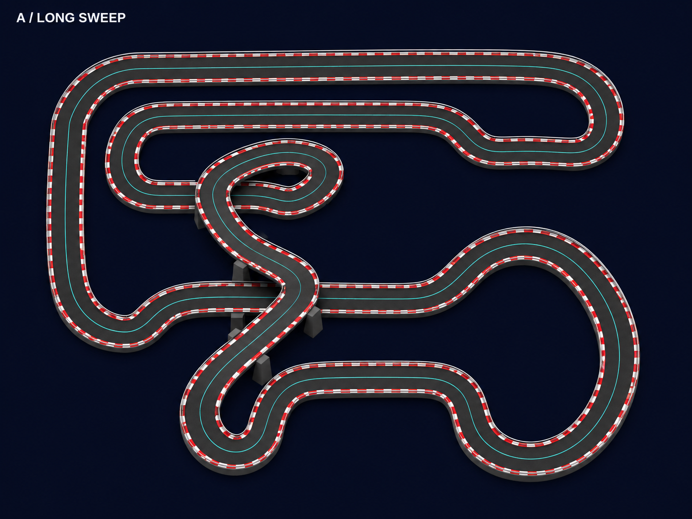
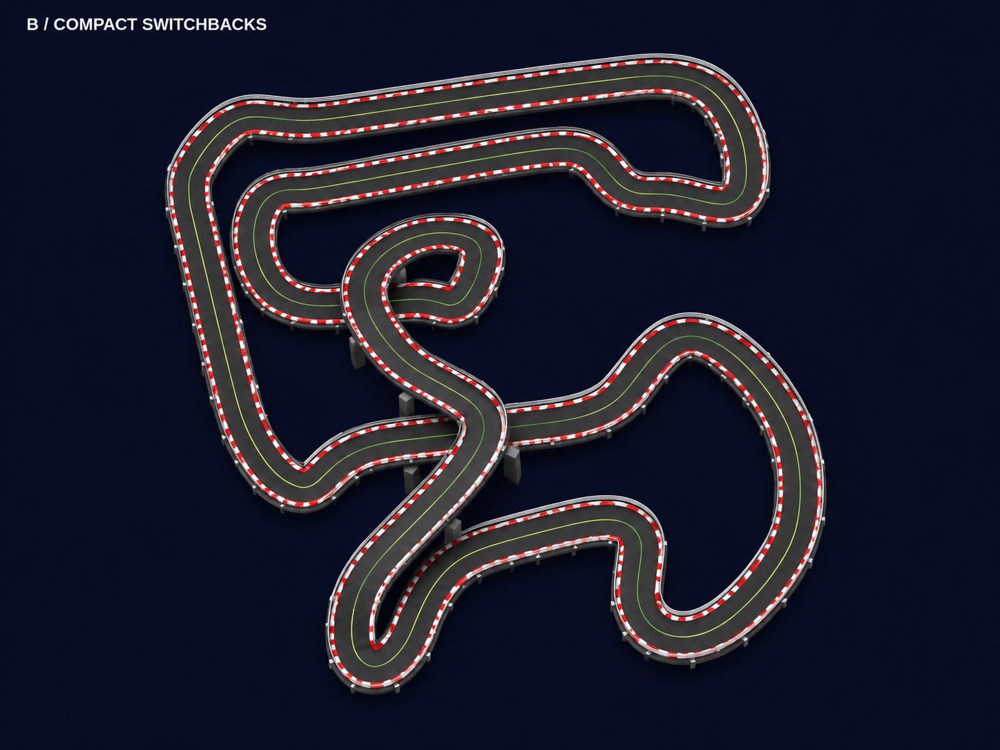
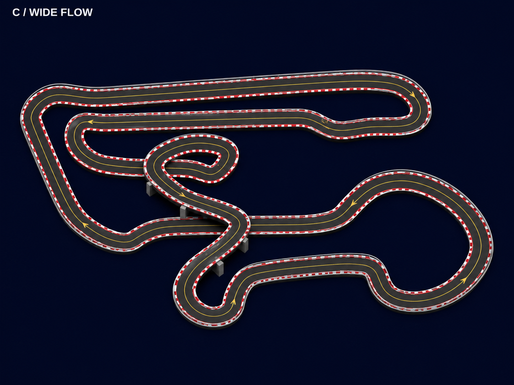
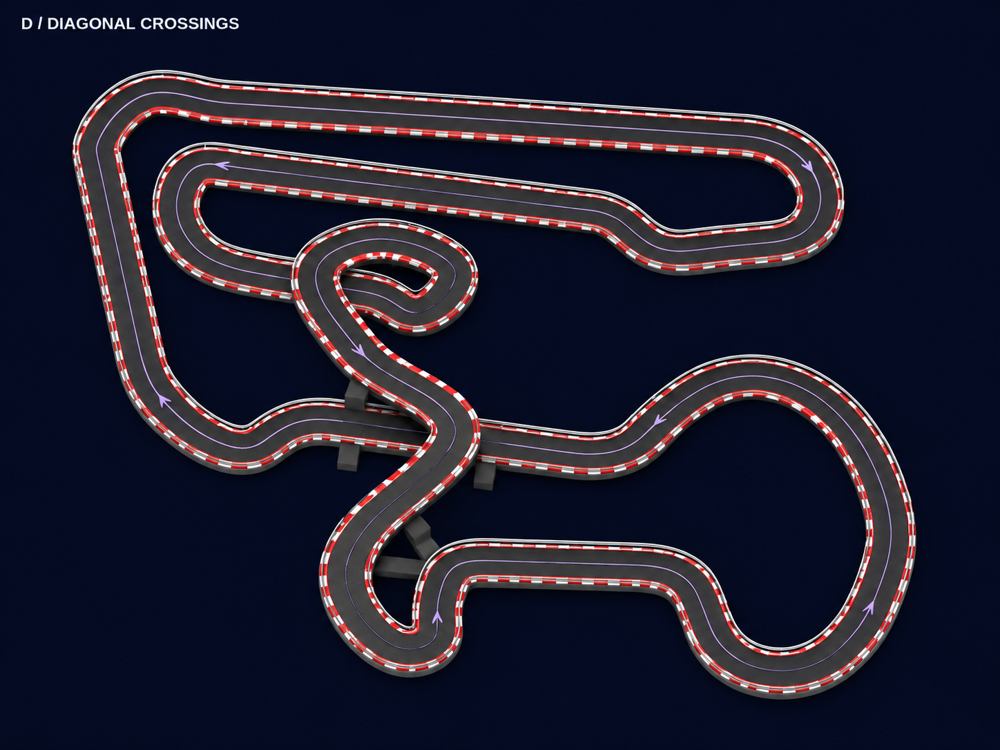

# Track image studies

The earlier studies below remain image-only concepts. The separately approved slot-car-style reference has now been adapted into the playable Skyline Circuit west of the slab; see [the reference](skyline-reference.png) and the Skyline section in [README](../README.md). Suzuka’s real route has also been adapted as a third playable circuit on the north side of the slab; see [its source map](references/suzuka.svg). Spa, Zandvoort and Interlagos are now connected into one three-level circuit on the south side of the slab. The original floor slab, circuit geometry, driving physics and saved ghosts are preserved.

## Revised concepts: existing-circuit variations

The four drawings start with the actual control points in `src/track.js` at commit `0acb416`. A raised central detour adds a second crossing; modest footprint and curve changes distinguish the variants. Each guide is a single closed curve. A sampled check of 900 segments found exactly two nonadjacent centerline crossings per guide, with approximately 10 m of height separation at those crossings.

The guide SVGs and JSON control points are design documents only and are not imported by the game. Centerline checks do not validate road edges, collision meshes or rendered pixels. The generated renders are visual interpretations; use the route guides as the connection plan for any later implementation.

### A — Long Sweep

Long upper straight, broad outer sweeps and a large lower-right lobe.

[Route guide](concepts/v2/a-guide.svg) · [Design data](concepts/v2/a.json)

### B — Compact Switchbacks

Narrower footprint, bent straights and tighter linked corners.

[Route guide](concepts/v2/b-guide.svg) · [Design data](concepts/v2/b.json)

### C — Wide Flow

Wider footprint with broad flowing bends and a longer upper straight.

[Route guide](concepts/v2/c-guide.svg) · [Design data](concepts/v2/c.json)

### D — Diagonal Crossings

Skewed footprint with a diagonal central bridge and angled outer sides.

[Route guide](concepts/v2/d-guide.svg) · [Design data](concepts/v2/d.json)

## Earlier reference-based studies

The earlier images remain available for comparison:

- [360 Karting concept A](concepts/360-concept-a.png)
- [Cinergy Midland concept B](concepts/cinergy-concept-b.png)

Original references:

- https://360karting.com/2023/03/01/behind-the-scenes-designing-and-building-the-largest-go-kart-track-in-the-world/
- https://360karting.com/project/cinergy-midland-tall-city-speedway-extreme-karting/

The user-supplied reference images guided those earlier concepts. Network policy denied access to 360karting.com, so the article, additional project views and the first facility's possible two-circuit configuration could not be verified. These are interpretations, not surveyed replicas.

Restore point before the layout editor update: Git tag `checkpoint-before-layout-and-tracks-2026-11-08`, commit `3fb6f4f`.
