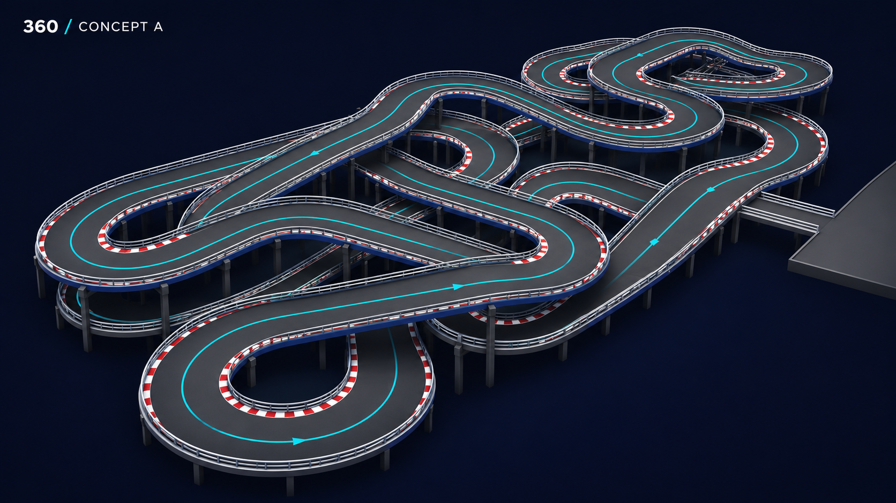
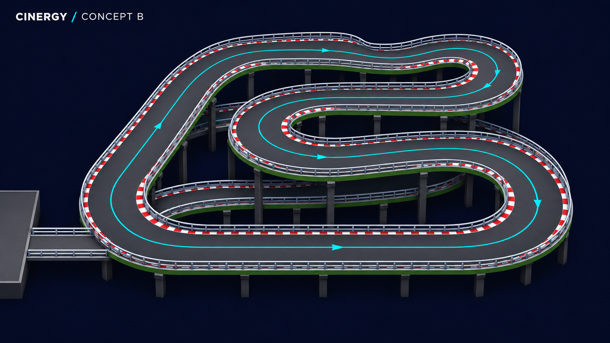

# Track image studies

These are image-only concepts requested for review. No new circuits are built into the game. The existing floor slab and racing circuit retain their geometry, collisions, lap timing and ghosts.

## 360 Karting concept A

Reference: https://360karting.com/2023/03/01/behind-the-scenes-designing-and-building-the-largest-go-kart-track-in-the-world/

## Cinergy Midland concept B

Reference: https://360karting.com/project/cinergy-midland-tall-city-speedway-extreme-karting/

The supplied reference images guided these concepts. The cloud environment's network policy denied access to 360karting.com, so the article, additional project views and the first facility's possible two-circuit configuration could not be verified. These images are interpretations, not surveyed replicas or validated route geometry. Any later implementation needs an explicit connected route plan and clearance checks before modeling.

Restore point before this update: Git tag `checkpoint-before-layout-and-tracks-2026-11-08`, commit `3fb6f4f`.
